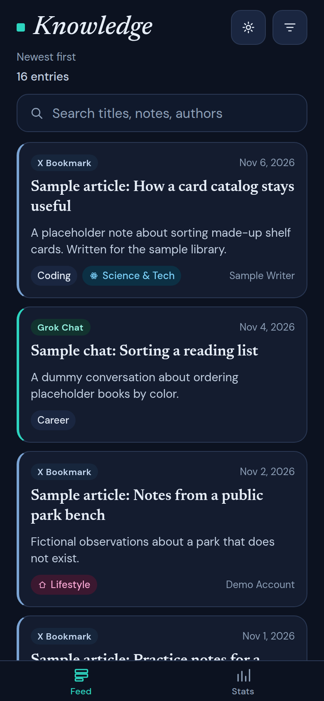
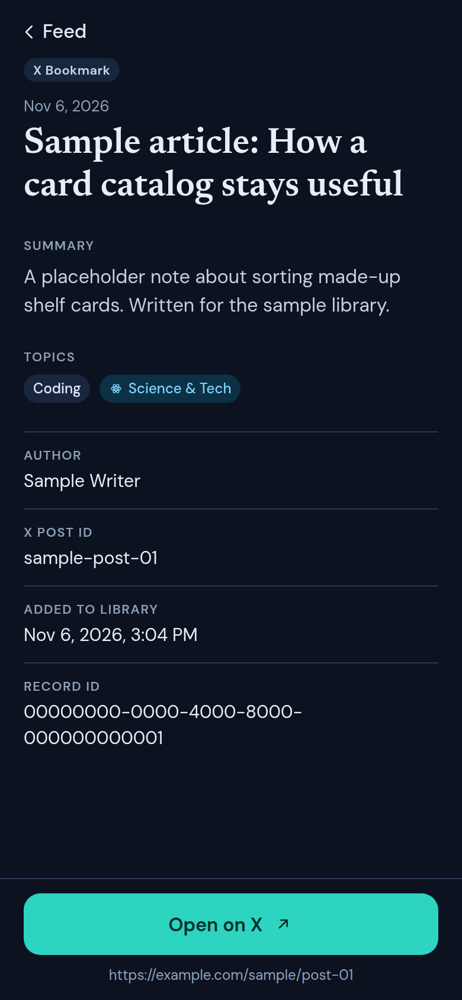
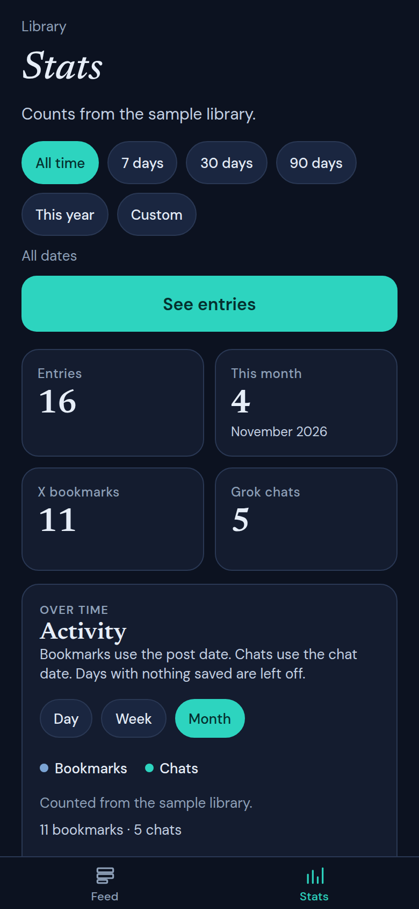
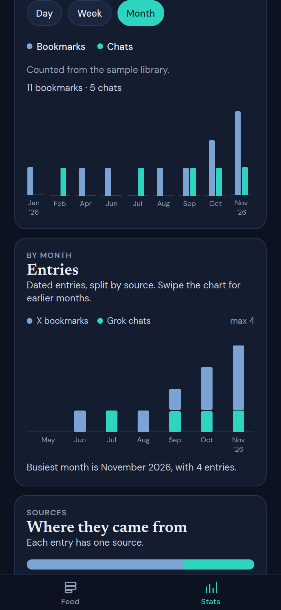
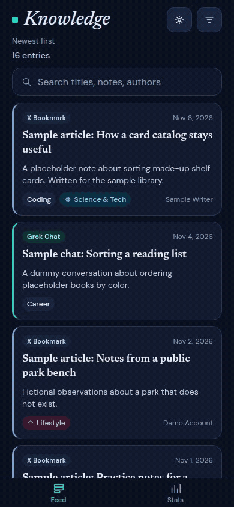

# Knowledge

Phone-first viewer for a library of saved bookmarks and chats. Mostly AI-generated with Cursor.

Entries live in Supabase (`public.items`). The app reads that table. A real library loads only when `EXPO_PUBLIC_SUPABASE_URL` and `EXPO_PUBLIC_SUPABASE_ANON_KEY` are set. This repository does not contain anyone’s saved bookmarks or chats.

## Features

- **Feed.** Newest first, 20 at a time, infinite scroll, and pull to refresh.
- **Search.** Full-text over titles, summaries, and authors (the `fts` column), using web search syntax such as `notes -draft` or `"exact phrase"`.
- **Filters.** Source, topics (match any), a month, or a date range with either end open. Topics with no saved entries are hidden. Filters and search combine.
- **Entry.** Source, date, title, summary, topics, author when one was saved, the post id or chat id, when it was added, and the record id. A button opens the stored link (“Open on X” or “Open in Grok”).
- **Stats.** Entries per month by source, source split, topic counts, and activity over time. Tap a month, source, or topic to cross-filter the totals and the other charts; tap it again to clear it. Last 7, 30, and 90 days, this year, all time, or a custom range narrow every chart. Chips remove a selection. See entries opens the feed with those filters.
- **Activity.** Bookmarks per day and chats per day, from each entry’s own date (the post date, or the chat date). Switch day, week, or month. Both series can be hidden from the legend. Tap a point to see that bucket’s counts and open the feed on it. Postgres counts the series (`activity_buckets` in `supabase/migrations`). Until that function is on the database, the chart groups the rows Stats already loaded and labels the totals “Counted on this phone.”
- **Theme.** Dark navy by default, with a teal accent. The sun/moon button switches to light and is remembered.

## Stack

| Part | Tech |
| --- | --- |
| App | Expo SDK 58, expo-router, React Native, TypeScript |
| Data | Supabase Postgres, read with `@supabase/supabase-js` |
| Charts | react-native-svg |
| Updates | EAS Update, channel `production`, runtime `exposdk:58.0.0` |

## Screenshots

The pictures below are a phone-sized web preview (390×844, touch) of the committed sample library. Titles, authors, and links are placeholders such as “Sample article” and `example.com`. They were not loaded from a Supabase project.

<p>
  
  
  
  
</p>



## Sample preview

```bash
EXPO_PUBLIC_DEMO=sample npm run web
```

`EXPO_PUBLIC_DEMO=sample` serves the rows in `lib/sample-items.ts` and does not call Supabase, even if the project URL is set. Leave the variable unset for a real library. Do not set it when you publish an update.

Sample search is a case-insensitive match on titles, summaries, and authors. A real project uses the `fts` column described above.

`node e2e/sample-shots.mjs` records the pictures in this README. Start the sample preview first (the script expects it at `http://127.0.0.1:44521`, or pass `APP`). It needs Chrome and Playwright’s ffmpeg (`npx playwright install ffmpeg`). It does not read Supabase credentials.

## Setup

```bash
npm install
cp .env.example .env
npm start
```

Scan the QR code with Expo Go (iOS or Android). For a browser preview, press `w`, or run `npm run web`.

Set these in `.env`. Leave them empty in git; put real values only in the local file.

| Setting | What it's for |
| --- | --- |
| `EXPO_PUBLIC_SUPABASE_URL` | Supabase project URL |
| `EXPO_PUBLIC_SUPABASE_ANON_KEY` | Anon (publishable) key. Row level security should allow select only. |
| `EXPO_PUBLIC_DEMO` | Optional. `sample` shows the committed fixture and skips Supabase. Leave unset for a real library. |

Only the project URL and the anon key belong in the client. The service-role key is never used by the app.

Apply `supabase/migrations/20261025223208_activity_buckets.sql` on the project so activity is aggregated in the database. This repo expects `public.items` (with the `fts` column search uses) to already exist. The migration here only adds `activity_buckets`.

## Publish

`app.config.ts` names the Expo project `@setwise-sixtus/knowledge` and project id `58df4489-fd92-4ae6-8644-2b9f3daa4c05`. Updates go to channel `production`. The runtime version follows the SDK (`exposdk:58.0.0`), which is what Expo Go reports.

```bash
npx eas-cli update --channel production --platform all --message "What changed"
```

Expo Go opens that channel from `exp://u.expo.dev/58df4489-fd92-4ae6-8644-2b9f3daa4c05?runtime-version=exposdk%3A58.0.0&channel-name=production`. After an Expo SDK upgrade, publish again and update the `runtime-version` in that URL.

The Supabase URL and anon key have to be present in the environment when you publish. The update bundle does not carry a fallback project. Whatever those variables point at is the library the published app reads. This repository does not include that data.

## Checks

```bash
npm run typecheck
npm run lint
```

`e2e/phone.mjs` drives a phone-sized browser (touch, feed, filters, an entry, and Stats, including the activity chart at day, week, and month) and compares counts with the Supabase project in the environment. It needs `EXPO_PUBLIC_SUPABASE_URL`, `EXPO_PUBLIC_SUPABASE_ANON_KEY`, `playwright-core`, and Chrome. Start the app with `npx expo start --web`, then run `node e2e/phone.mjs`. Pull to refresh is wired for the phone app; the web preview does not fire it. Use `e2e/sample-shots.mjs` when you want pictures of the fixture instead of a live project.

## Layout

```
app/          Expo Router screens (feed, stats, entry)
components/   Cards, charts, filters, icons
lib/          Supabase client, queries, sample fixture, stats, theme
e2e/          Phone-sized browser scripts
supabase/     activity_buckets migration
docs/         Sample screenshots
assets/       App icon and splash
```

## Privacy

Point the app at a Supabase project you control. Saved bookmarks and chats stay in that database. The only rows in this repository are the obvious placeholders in `lib/sample-items.ts`, used for the sample preview and the screenshots above.

## License

[MIT](LICENSE)
